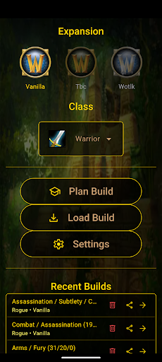
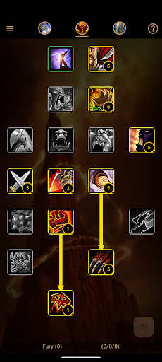

# LTC: Legacy Talent Calculator

[](https://discord.gg/ncKmDEArqg)
[](LICENSE)
[](https://flutter.dev)
[](#getting-started)

A free, open source talent calculator for World of Warcraft, for Android and iOS. Plan a build, save it, and share it, in English or German.

LTC is a non-commercial fan project. It has no ads or purchases, and it isn't for sale.

<a href="https://play.google.com/store/apps/details?id=de.oppahansi.ltcfree"></a>

 

## Features

- **Talent calculator:** interactive trees that enforce row requirements, prerequisites and point limits, with undo and a build order view.
- **Saved builds:** save builds on your device with your own titles.
- **Sharing:** export and import compact share codes that carry the build order.
- **Backups:** export and restore your saved builds through the system file picker.
- **English and German:** switch language at any time.

## Supported game versions

| Edition | Versions | Status |
|---|---|---|
| **Original**, the clients from back then | Vanilla 1.12.1, TBC 2.4.3, WotLK 3.3.5a | Available |
| **Classic**, today's re-releases | Vanilla, TBC, WotLK | Planned |
| **Forever** | Its own talent trees | Planned |

Original edition data is checked against the original game clients. German Vanilla text is the exception: it hasn't been compared with a German client yet.

## Getting started

You need [Flutter](https://docs.flutter.dev/get-started/install) 3.47 or newer. The app runs on iOS 15 or newer, and on Android versions supported by your Flutter release.

```bash
flutter pub get
flutter run
```

Release builds:

```bash
flutter build apk --release   # Android: needs android/key.properties for signing
flutter build ios --release   # iOS: needs your own signing team
```

## Development

| Task | Command |
|---|---|
| Run the tests | `flutter test` |
| Lint, including `riverpod_lint` | `flutter analyze` |
| Regenerate Riverpod providers | `dart run build_runner build` |
| Regenerate strings, after editing `lib/l10n/*.arb` | `flutter gen-l10n` |

Generated `*.g.dart` and `lib/l10n/app_localizations*.dart` files are committed, so regenerate them along with any change to their source.

### Talent data

- `assets/db/*.db.sql` is the source of truth. Edit the SQL, then rebuild the matching `.db` from it.
- Bundled databases are only copied on first install, so existing installs need a migration to receive changes.
- Talent and expansion ids must not change, because saved builds and share codes refer to them. The tests guard this.
- `tool/` has read-only scripts for checking data against game clients. See [tool/README.md](tool/README.md).

### Project structure

```
lib/
├── app/         App widget and routes
├── core/
│   ├── db/            SQLite setup and migrations
│   ├── game/          Expansions, classes, talents
│   ├── navigation/    Route names
│   ├── settings/      Preferences and language
│   ├── talent_build/  Saved builds and share codes
│   ├── utils/         General helpers
│   └── widgets/       General widgets
├── features/
│   ├── builds/        Saved builds list and share code import
│   ├── calculator/    Talent trees and rules
│   ├── home/          Expansion and class selection
│   └── settings/      Preferences screen and backups
└── l10n/        Strings, in English and German
```

`test/architecture_test.dart` enforces which parts may depend on each other.

Built with Flutter, [Riverpod](https://riverpod.dev) and SQLite.

## Contributing

Bug reports and ideas are welcome, either in [issues](https://github.com/oppahansi/nltc/issues) or on [Discord](https://discord.gg/ncKmDEArqg). Please run `flutter test` and `flutter analyze` before opening a pull request.

## Privacy

LTC collects and shares no data. See the [privacy policy](PRIVACY.md).

## Disclaimer

LTC is an unofficial fan project and isn't affiliated with or endorsed by Blizzard Entertainment. World of Warcraft, its talent data and its artwork are trademarks or copyrights of Blizzard Entertainment, Inc. If you represent a rights holder and want something removed, please open an issue.

## License

The source code is licensed under the [MIT License](LICENSE). This doesn't cover the game data and artwork described above.
